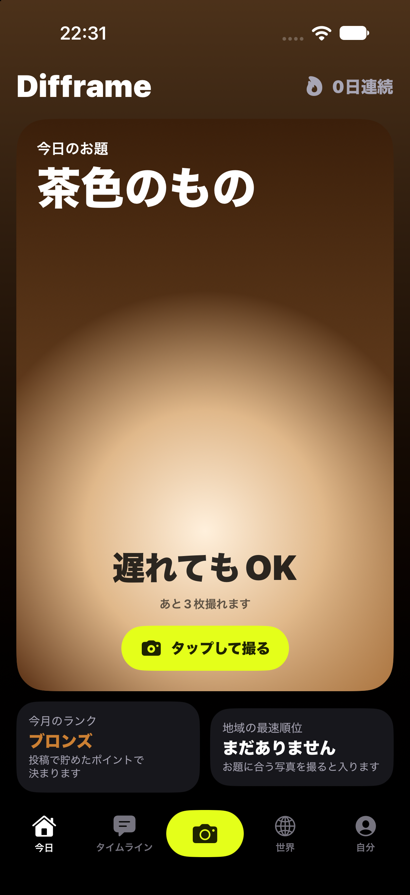
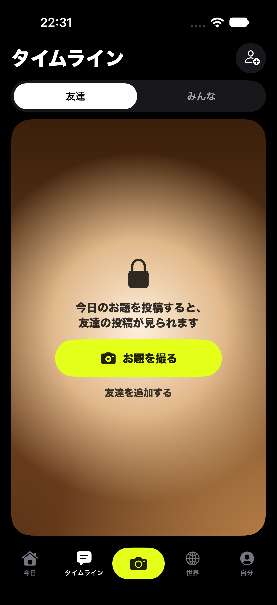
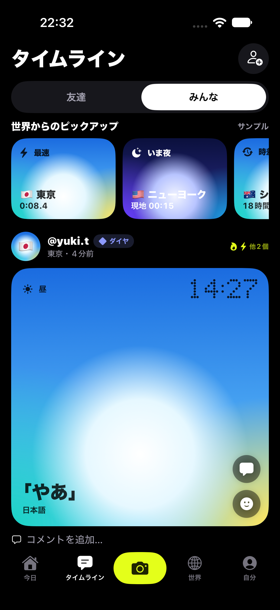
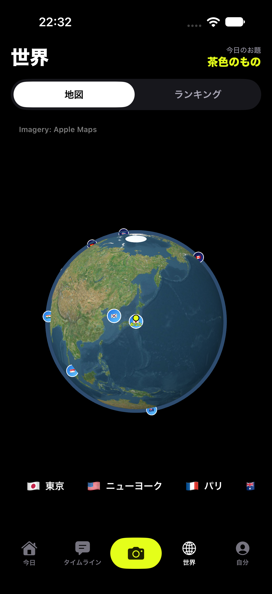
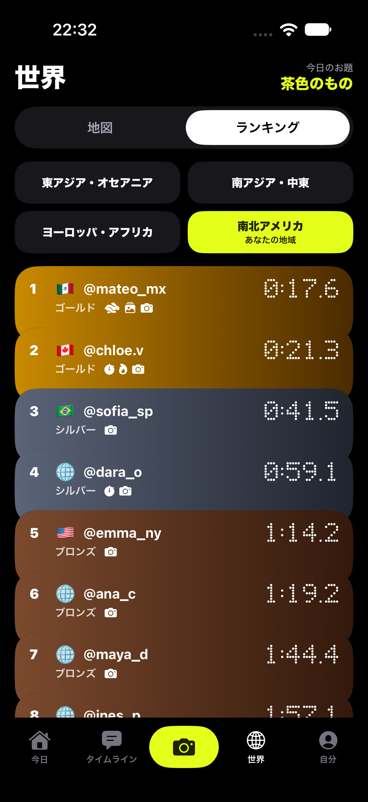
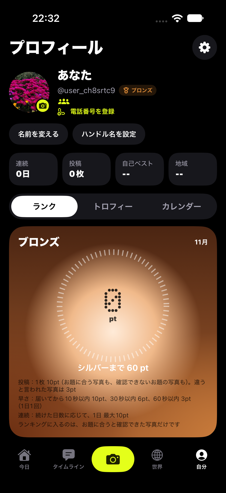

# Difframe

**Same prompt. Different worlds.** A small daily ritual for people who live far from home.

Everyone gets the same photo prompt at the same moment (for example "something brown" or "a window"). You answer with one photo, taken on the spot. Because the prompt is shared, your photo can be compared with a friend's in another country, or a stranger's on the other side of the world.

iOS app written in SwiftUI, with a Firebase back end. Submitted to the STEM2Connect AI Hackathon 2026 (track: local community impact, with accessibility).

## Why we built it

Millions of people live far from the people they love: international students, migrant workers, families split across time zones. Distance does not only mean fewer messages. It means missing the ordinary moments. Chat apps assume you already know what to say. A shared prompt gives you something to say without needing to say anything.

## Screenshots

| Today | Timeline (friends) | Timeline (everyone) |
|---|---|---|
|  |  |  |

| World map | Ranking | Profile |
|---|---|---|
|  |  |  |

## Where AI is used

The AI in the app is a set of small helpers that run **on the device**. No photo or text is sent to an AI service.

| Feature | What it does | Technology |
|---|---|---|
| Prompt check | Checks that a photo matches the prompt before it counts for the ranking. A mismatch shows a gentle warning and never blocks the post. | Apple Vision (`VNClassifyImageRequest`) |
| Color prompts | Prompts such as "something brown" use a pixel color check, because a classifier is the wrong tool for color. | Pixel sampling on the image (no model) |
| Photo description | Names what is in a photo ("cat, sofa"), suggests a caption, and saves a short description so VoiceOver can read friends' photos aloud. | Apple Vision |
| Translate button | Translates a caption, comment, or message into the reader's language. The text never leaves the phone. Needs iOS 18. | Apple Translation framework, NaturalLanguage (language detection) |

We kept the AI small on purpose. It protects fairness and privacy and makes the app more accessible; it is not a chatbot, so the app stays a connection between people.

## Features

- **One prompt a day.** A notification starts a timer. A heads-up notification and a countdown card appear 30 minutes before. Widgets and a Live Activity (Dynamic Island and Lock Screen) show the prompt.
- **In-app camera** with pinch zoom, lens buttons for each iPhone, and front and back capture.
- **World time attack.** The time from notification to post is recorded and ranked by region and worldwide.
- **Ranks.** Eight rank tiers, from Bronze to Legend, based on monthly points. Friends get a push notification when someone ranks up (each person can turn it off).
- **World tab.** A world map of public posts (MapKit) that shows the local time of the place you are looking at as you zoom in, plus a "World now" strip with the real local time of twelve cities.
- **Today's 10.** Ten random public photos each morning. People can opt out of being picked.
- **Timeline** for friends and for everyone, with comments, emoji reactions, and likes. Each post has its own audience and comment setting.
- **Friends** by QR code or link, with friend requests.
- **Direct messages:** text, photos, voice messages, emoji reactions, read receipts, and typing indicators.
- **Privacy and safety.** Only a city name is shown for a location (rounded to about 10 km, with the zoom capped). Users can report, block, and delete their account in the app. There are no ads and no tracking.
- **Six languages:** Japanese, English, Chinese, Korean, Spanish, French.
- **Swipe navigation** between the main tabs and back from full-screen screens.

## Tech stack

Swift and SwiftUI, AVFoundation, Vision, Translation, NaturalLanguage, MapKit, CoreLocation, Core Image (QR codes), WidgetKit, ActivityKit, UserNotifications, BackgroundTasks, Firebase Authentication (phone sign-in), Cloud Firestore, Cloud Functions (Node.js) with APNs for push notifications, Firebase Hosting for the privacy policy.

## Requirements

- Xcode 16 or later and macOS
- iOS 18.6 (the checked-in project setting). The Translate button needs iOS 18.

## Build and run

The Xcode project is generated by a script:

```bash
python3 make_hitokoma_xcodeproj.py "$PWD/Hitokoma"
open Hitokoma.xcodeproj
```

Then choose an iPhone simulator and press Run. The camera does not work in the simulator, so the app uses test images there.

## Server

Friends, posts, comments, messages, and notifications use Firebase. The security rules are in [firestore.rules](firestore.rules), and the Cloud Functions that send push notifications are in [firebase/functions](firebase/functions).

To use your own Firebase project:

1. Set the project ID and Web API key in `Hitokoma/CloudConfig.swift`.
2. Add your own `GoogleService-Info.plist` to `Hitokoma/` (it is not in this repository).
3. Enable Anonymous and Phone sign-in, and publish the rules.
4. For push notifications, add your Apple Push key (`.p8`) and key ID with `firebase/setup_push.sh`, then deploy the functions. The key and the `.env` file are never committed.

Without a server, the app still works on the device, and phone sign-up falls back to a demo provider that shows the code on screen.

## Notes and limits

- The Web API key in `CloudConfig.swift` is a Firebase client key. Access is controlled by the security rules, not by hiding that key.
- The camera does not work in the simulator.
- Photos in messages are kept small (under about 800 KB), and voice messages are limited to 60 seconds.
- The app is a prototype and is not on the App Store.

## AI use and attribution

We used AI in three ways. All are described here and on our Devpost page.

**1. AI coding assistant (development).** Most of the code was written with **Claude Code** (Anthropic), an AI coding assistant, working from our directions: it wrote and refactored Swift and SwiftUI code, the Firebase security rules, the Cloud Functions, and the localized strings, and it helped debug build and device problems. We set the product idea and goals, chose the features, reviewed the changes, built the app, and tested it on real iPhones. Decisions about privacy, safety, and what the app should feel like are ours.

**2. AI features in the app.** Apple Vision, Apple Translation, and NaturalLanguage (language detection), as described in [Where AI is used](#where-ai-is-used). They run on the device.

**3. AI voice (demo video).** The narration of our demo video was generated with **ElevenLabs** text-to-speech from a script we wrote. The video says so in the narration. The screen footage and the script are ours.

## License

No license has been chosen yet. All rights reserved by the authors.
