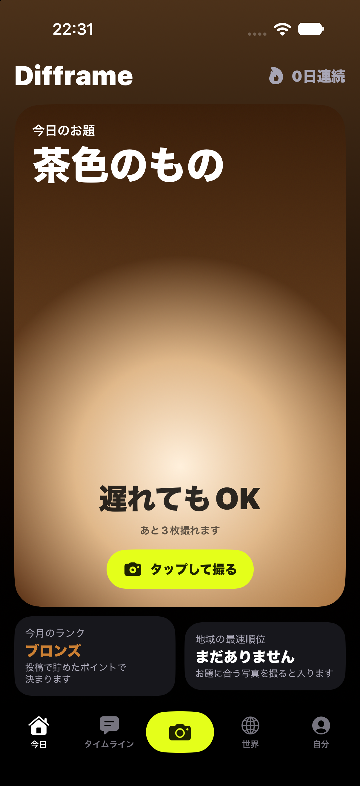
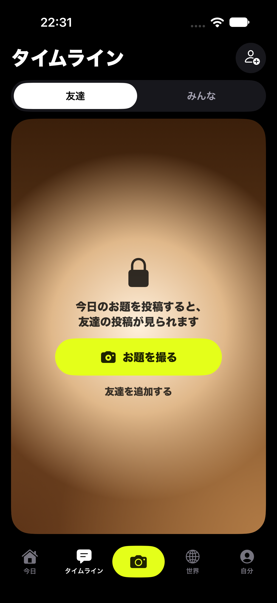
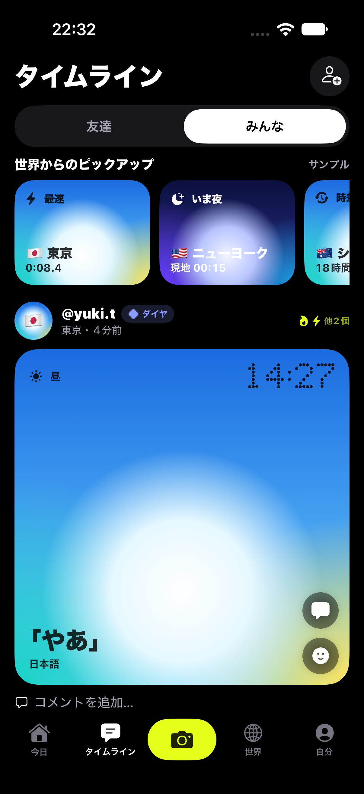
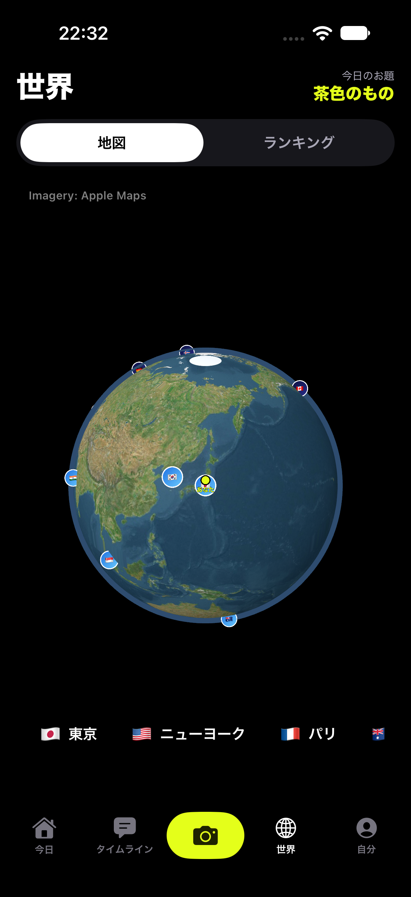
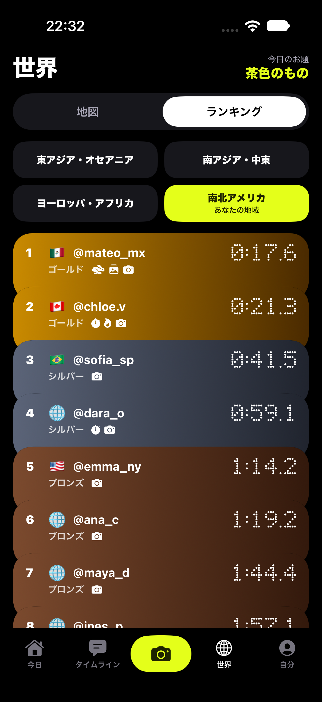
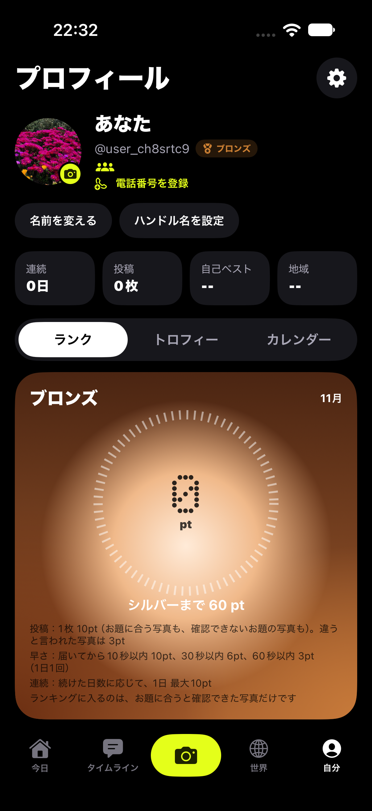

# Difframe

**One shared daily prompt, photographed around the world.**

Every day, everyone gets the same prompt by notification (for example, "something brown"). You have a short time to take a photo that fits it, and then you can see how the same prompt looks in other places and times around the world.

Built for IceHacks 2026. iOS app written in SwiftUI (iOS 17+).

## Screenshots

| Today | Timeline (friends) | Timeline (everyone) |
|---|---|---|
|  |  |  |

| World globe | Ranking | Profile |
|---|---|---|
|  |  |  |

## Features

- Daily prompt by notification, with a timer that starts when it arrives
- In-app camera with pinch zoom, lens buttons that match each iPhone, and front/back capture
- Photo check: a Vision-based image classifier confirms that a photo matches the prompt; color prompts use a pixel color check
- World tab: a rotating globe and map of posts from around the world, with local time and light
- Timeline: friends and everyone, with comments, emoji reactions, and double-tap likes
- Per-post choice of audience (friends, everyone) and whether to allow comments
- Optional city name on a post (only the city, never the exact location)
- Calendar, rankings, trophies, and a share card for Stories
- Friends by QR code or link: send a friend request, accept it, and see each other's posts
- Direct messages between friends: text, photos (including a photo taken in the chat), voice messages, emoji reactions, read receipts, and typing indicators
- Send a friend's post into a chat
- Block and report, from comments and profiles
- Notification settings: turn each kind of notification on or off
- Five languages: English, Japanese, Chinese, Korean, Spanish

## Requirements

- Xcode 16 or later
- iOS 17 or later
- macOS to build

## Build and run

The Xcode project is generated by a script:

```bash
python3 make_hitokoma_xcodeproj.py "$PWD/Hitokoma"
open Hitokoma.xcodeproj
```

Then choose an iPhone simulator and press Run.

## Server

Friends, posts, comments, messages, and notifications use Firebase (Authentication and Cloud Firestore), called through the REST API. The security rules are in [firestore.rules](firestore.rules). Setting up your own copy needs your own Firebase project: set the project ID and Web API key in `Hitokoma/CloudConfig.swift`, enable Anonymous sign-in, and publish the rules.

Without a server, the app still works on the device.

## Notes and limits

- The world feed shows sample posts from other users, labeled as samples in the app. Posts from real users appear when people share them.
- Notifications for the daily prompt are scheduled on the device. Notifications for friends' actions (comments, likes, requests, messages) appear when the app is opened, or when iOS runs a background check. They do not arrive as push notifications while the app is closed; that needs an Apple Developer account and a server-side sender.
- Phone number sign-up uses a demo provider: the code is shown on screen and no SMS is sent.
- The camera does not work in the simulator; the app uses test images there.
- Photos in messages are kept small (under about 800 KB), and voice messages are limited to 60 seconds.
- The app is a prototype and is not on the App Store.

## AI use

Most of the code was written with the help of Claude (Anthropic), an AI coding assistant, under the author's direction. The author reviewed, tested, and chose the design and features.

## License

No license has been chosen yet. All rights reserved by the author.
